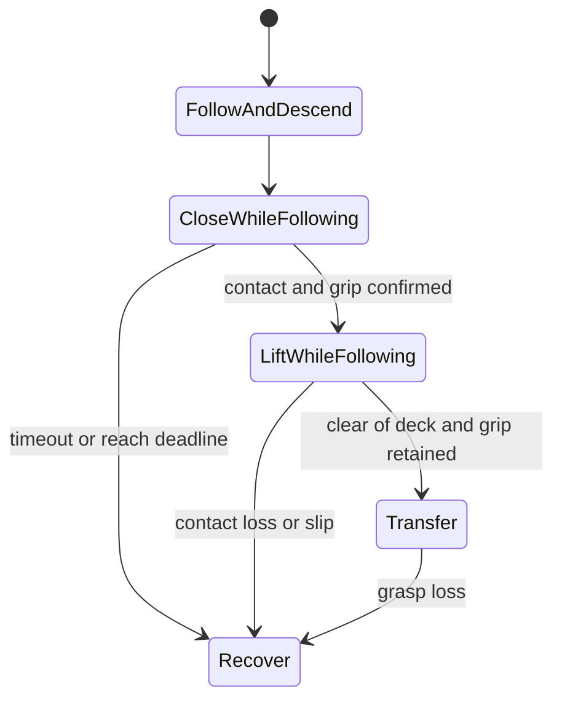

# Parcel grasp confirmation and prompt lift

Status: proposed implementation plan; no controller or motion changes made by this
planning task. Work remains in the mirror. Preserve the tested continuous belt and
parallel startup while introducing the new grasp behavior behind a mode option.

## Objective and measured baseline

Lift promptly after a credible grasp is established, detect a lost carton, and
separate deliberate conveyor following from carton slip relative to the fingers.

Current continuous mode closes for 1.0 simulated second, keeps following at grasp
height for another 0.6 s, then lifts for 1.3 s. Its single scheduled arm trajectory
cannot lift early when a check succeeds. The saved six trials took 2.85–3.06 wall s
to close and 9.49–10.42 wall s from closing start to completed lift. At 0.06 m/s,
the planned travel before lift begins is 96 mm, including 36 mm after closing ends.
These distances are world travel, not a measurement of jaw-relative slip.

Baseline evidence: `logs/parcel_startup/grip_timing_analysis.json` and
`logs/parcel_startup/quick_gui_02/`. First-contact and actual lift-onset wall times
were not separately logged; do not report interpolated estimates as measurements.

## 1. Correct grasp-loss detection and record the missing evidence

Implement a small ROS-independent grasp-state evaluator in a proposed
`parcel_grasp.py`, fed by the existing observation node. Keep per-finger positions,
total jaw gap, current desired positions, feedback age and gap velocity explicit.

- Let total gap be `g = q1 + q2` and mean finger position be `w = g / 2`.
  The carton seats at approximately `g=50 mm`; the current final close command is
  `g_cmd=40 mm`. Do not mix total-gap and per-finger thresholds.
- Repeat the compression/blocked-opening criterion during lift and transfer. With
  the existing per-finger margin of 1.5 mm, `w - w_cmd > 1.5 mm` excludes an empty
  hand at the commanded 20 mm. The existing broad 19–31 mm mean-width gate alone
  does not exclude that empty state.
- Replace the unsuitable 8 mm relative-drop threshold for this mode: the entire
  seated-to-empty difference is only about 5 mm per finger. Calibrate a discriminating
  loss threshold from observed loaded/empty distributions, with hysteresis.
- During closure, compare measured position with the *current interpolated command*,
  not just its final target. Normal in-progress closure must not masquerade as a stall.
- Use gap stability/velocity, not equality of the two finger positions: the independent
  fingers can move in opposite directions while the total opening remains constant.
- Log `CLOSE_START`, `FIRST_CONTACT`, `BILATERAL_CONTACT`, `GRASP_CONFIRMED`,
  `LIFT_REQUESTED`, `ACTUAL_LIFT_ONSET`, `DECK_CLEAR`, `TRANSFER_START` and loss reasons.
  Mark each event's measurement source; actual payload lift/clearance comes from the
  independent observer. Store integer simulation timestamps and monotonic wall times.

Unit acceptance: empty close, lost carton, wrong-size obstruction, one blocked finger,
stale/NaN/duplicate feedback and timestamp boundaries cannot establish a grasp. A
correct seated gap with legitimate finger see-saw remains valid.

## 2. Add evidence that both pads actually contact the carton

Add optional contact sensing to the parcel launch's temporary robot description,
using existing finger collision geometry. Add the required contact system only to
the parcel world configuration. Preserve shared URDF geometry, inertia, joint limits,
controllers and camera calibration. Verify generated collision names and the installed
Gazebo/ROS transport mapping before relying on the messages. Gazebo Harmonic provides
[contact sensors](https://gazebosim.org/docs/harmonic/sensors/#contact-sensor).

Require fresh contacts on both pads with the same parcel, together with plausible
gap, blocked motion and low gap velocity. Reject belt/rail/fixture contacts, one-sided
contact and ambiguous association with the selected camera track. Missing contact
messages mean unknown, not zero slip or a confirmed grasp.

Start with a provisional 0.10–0.20 simulated-second persistence window; choose the
final value from measured noise and contact-loss trials. Contact presence is not a
calibrated force measurement. Record valid contact wrenches if exposed, but do not
invent a force value from position error or require an arbitrary newton threshold.
Force-controlled actuation is a separate addition if these signals prove insufficient.

Acceptance: demonstrate two-pad contact, empty closure, single-pad contact, fixture
contact and lost/stale sensor cases before making contact part of automatic lifting.

## 3. Make confirmation trigger a continuous lift

Replace the fixed hold-then-lift schedule with these phases:

Keep a bounded following trajectory available while closing. When confirmation
succeeds, construct/select a lift from the expected handover state, preserving
horizontal belt velocity and smoothly adding vertical motion. Precompute feasible
lift candidates during closure where possible so planning does not become a new wait.
Preserve existing collision, joint velocity/acceleration and execution-arrival checks.
Include the carried-parcel planning proxy during the lift; permit only its necessary
initial support contact with the belt, rather than disabling robot/environment checks.
The proxy is planning geometry, not a Gazebo attachment or teleportation mechanism.

First prove the installed controller's handover behavior with an unloaded hand.
Do not assume a future-stamped replacement preserves the old trajectory: the
[Jazzy trajectory documentation](https://control.ros.org/jazzy/doc/ros2_controllers/joint_trajectory_controller/doc/trajectory.html#trajectory-replacement)
states that replacement discards the old trajectory. Use a tested replacement that
includes the necessary continuation and matching boundary state/velocity. If that
cannot provide continuous motion, resolve the streaming/handover mechanism before
enabling event-triggered payload lifting. Cancel-then-plan, which can stop the hand
while the carton continues, is not an acceptable normal transition.

Never lift automatically merely because the close action returned success. Never
fall back silently to the old scheduled lift when confirmation is absent.

Initial performance targets, subject to measurement:

- Confirmation-to-actual-lift median at most 0.25 simulated seconds.
- Closing-start-to-lift median approximately 1.2–1.3 s, versus the current 1.6 s,
  when the contact evidence supports that timing.
- Keep the initial 1.0 s closing stroke and existing lift height/dynamic limits until
  feedback and handover are validated. Tune the closing stroke afterward, separately.

Report median/p95, simulation time, wall time and real-time factor. These are targets,
not achieved results; a slower GUI alone does not establish a gripping delay.

## 4. Measure slip and define recovery

The independent evaluator must record actual carton pose relative to the actual hand:
`T_hand_object = inverse(T_world_hand) * T_world_object`. Validate transform composition;
world displacement or distance from a commanded path is not a slip metric. Sample fast
enough to resolve the confirmation window (target at least 50 Hz simulated, verify the
actual source rate), recording relative translation/orientation and actual lift onset.
These Gazebo poses remain evaluation inputs, not controller targets.

Runtime uses pad contacts and gap/compression continuously during lift and transfer.
Where a camera can observe the held carton, add a confidence-qualified relative pose
estimate. The present deck-plane detector cannot track a lifted carton, and the hand
can occlude it: do not treat absent detections as zero motion. Establish observability
before claiming continuous runtime slip detection. If required, add a dedicated held-
carton perception region/view or validate a pad-contact-motion estimate as a slip cue.

Use contact debounce/hysteresis calibrated against independent motion so a brief
physics contact flicker does not produce false loss. Persistent loss, collapse toward
the empty gap, stale feedback, excessive relative slip or an expired reach window
inhibits transfer and stops feed. Use a bounded hold/controlled lowering when feasible;
never home or blindly retry while a carton may be held. Require reset when state is
uncertain. Normal successful picks and placements keep the belt running.

## 5. Tests, integration and promotion

Proposed code ownership:

| Component | Responsibility |
| --- | --- |
| `parcel_grasp.py` (new) | Pure state evaluator, units, confidence, hysteresis, loss detection |
| `parcel_continuous.py` | Feedback collection and follow/close/lift transitions |
| `parcel_cell_scene.py` | Payload collision proxy through the lift |
| Parcel launch/generator/bridge configuration | Optional pad sensors and their transport |
| `parcel_task.py` | Development mode selection and failure propagation |
| New grasp observer/checker and offline tests in `tools/` | Independent slip/timing verdicts and fault cases |

Keep the current scheduled mode selectable while implementing a confirmed mode
(proposed `--grasp-mode scheduled|confirmed`, scheduled remaining the development default).
Develop in this order: detection correctness/telemetry; pad sensing and calibration;
unloaded controller-handover proof; event-triggered payload lift; timing tuning.

Require these acceptance checks before selecting confirmed mode by default in the mirror:

1. Offline evaluator/trajectory checks reject empty-hand and grasp-loss cases, including
   the exact current 40 mm empty-gap false-positive. Preserve legitimate see-saw cases.
2. Fault-injection runs cover no carton, one-pad/fixture jam, contact dropout/staleness,
   dropped/slipping payload and delayed controller response. Empty/foreign contacts
   must not confirm a grasp; injected loss must revoke an earlier confirmation and
   inhibit transfer. No transfer of an unconfirmed payload.
3. At least two fresh GUI batches pass 6/6 actual upright, stable, full-footprint tote
   placements, independent perception, continuous belt evidence and operational health.
   Complete at least 20 normal picks overall with failures retained and explained.
4. Independent relative-motion measurements show no sustained post-confirmation slip
   above a calibrated limit. Begin evaluation with a provisional 3 mm translation limit
   sustained for 0.10 s, accounting for measurement noise; also report angular slip.
5. Recorded timing shows earlier lift onset, with no hand stop/discontinuity at handover,
   and no loss of the faster parallel startup. Do not raise belt speed to mask delay.
6. Run an indexed regression if shared grasp/scene/sensor code changes, check source
   manifests, and save exact evidence and process cleanup in the shared handoff.

Keep belt speed at 0.06 m/s and current spacing while evaluating the grasp change.
Retain strict final placement verdicts and the existing treatment of teardown exit 245:
it is only a known post-completion exception after independent passes. Work in the
mirror; primary promotion, publication and unrelated perception work are outside scope.
