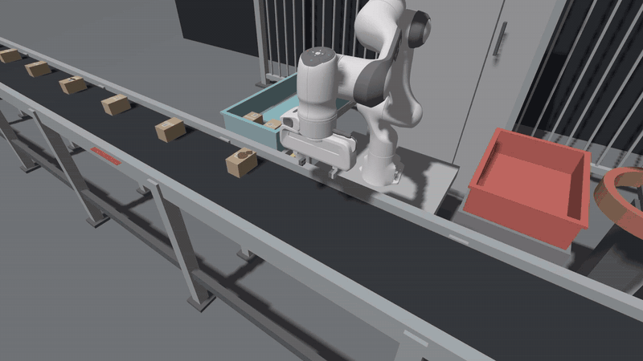
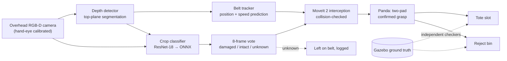

# Vision-Guided Pick-and-Sort Cell

**ROS 2 digital twin with learned damage inspection.** A simulated Franka Panda picks parcels from a moving
conveyor using a calibrated RGB-D camera. A CNN trained only on synthetic simulator images flags damaged parcels,
and the arm routes them to a reject bin. Every result is checked against Gazebo ground truth, never against the
robot's own log lines.

[](https://github.com/ptchpmk0100/language-controlled-panda-digital-twin/actions/workflows/ci.yml)




*12 s at 3× speed. Full run: [4× video (1:52)](https://github.com/ptchpmk0100/language-controlled-panda-digital-twin/releases/download/v1.0/demo-4x.mp4) ·
[real-time recording (7:27)](https://github.com/ptchpmk0100/language-controlled-panda-digital-twin/releases/download/v1.0/simulation-full.mp4)*

## Results

All numbers come from simulation, judged by independent checkers that read Gazebo entity poses.

| What | Result | Evidence |
|---|---|---|
| Picking from a moving belt (0.045 m/s, 10 parcels per run) | **40/40** parcels placed over 4 fresh runs, slot error **0.2–5.3 mm**, about 7 s per pick | [report](docs/results/PARCEL_PICKING.md) · [runs](evidence/parcel_cell/) |
| Damage classifier, held-out recordings | **30/30** parcels correct; on crops cut at the live detector's boxes: damaged **232/232** caught, **3/170** intact flagged | [report](docs/results/PARCEL_CONDITION_CLASSIFIER.md) · [metrics](evidence/parcel_condition/training/r1/eval_test.json) |
| Classifier-driven routing | **30/30** parcels in the right container over 3 runs (damaged → bin, intact → tote) | [checker output](evidence/parcel_condition/arm_runs/) |
| Live inference (ONNX Runtime, CPU) | about **15 ms** per frame, p95 29 ms | [node log](evidence/parcel_condition/arm_runs/armC/condition_node.log) |
| Hand-eye calibration (Kabsch SVD) | RMS residual **0.37 mm** over 24 correspondences | [calibration file](src/twin_action_demo/config/overhead_camera_extrinsic.yaml) |

## How it works



1. **Perception.** The depth detector finds each carton's top plane in the depth image (independent of colour) and
   deprojects it through the calibrated camera transform. No simulator pose is used at run time.
2. **Inspection.** A 64 px RGB crop around each detection goes to a ResNet-18 fine-tuned on 3,056 synthetic crops.
   The mean of the last 8 votes decides: ≥ 0.75 damaged, ≤ 0.25 intact, anything else is left on the belt and logged.
3. **Motion.** The arm launches a collision-checked intercept as soon as a tracked carton is reachable, follows the
   belt while descending, and lifts only after both finger pads report contact.
4. **Synthetic data.** Damaged and intact parcel variants (stains, tears, crushed corners; identical physics) are
   generated per run; labels come from the spawn manifest and projected Gazebo poses, and the split is by whole recording.

**Skills shown:** ROS 2 · MoveIt 2 · Gazebo · Python · PyTorch · ONNX Runtime · OpenCV · computer vision ·
deep learning (CNN transfer learning) · synthetic training data · model evaluation · RGB-D perception ·
hand-eye calibration · motion planning · pick-and-place · digital twin · defect detection · GitHub Actions CI · Linux

## Run it

Requires Ubuntu 24.04 with ROS 2 Jazzy, Gazebo Harmonic and MoveIt 2.

```bash
git clone https://github.com/ptchpmk0100/language-controlled-panda-digital-twin.git panda_cell && cd panda_cell
source /opt/ros/jazzy/setup.bash && colcon build
bash tools/run_offline_tests.sh            # unit and contract tests, no simulator (same as CI)

tools/parcel_demo.sh sim                   # terminal 1: Gazebo, camera detector, contact sensors
tools/parcel_demo.sh task                  # terminal 2: the camera-guided arm picks 10 parcels
```

With the damage classifier (separate Python venv for ONNX Runtime):

```bash
python3 -m venv ~/venvs/parcel_cls && ~/venvs/parcel_cls/bin/pip install -r tools/requirements-classifier.txt
curl -LO https://github.com/ptchpmk0100/language-controlled-panda-digital-twin/releases/download/v1.0/condition-model-r1.onnx
export COUNT=10 CONDITION_MODEL=$PWD/condition-model-r1.onnx VARIANT_DAMAGED=3,6,9
tools/parcel_demo.sh sim                   # terminal 1 (same exports)
tools/parcel_demo.sh task                  # terminal 2 (same exports)
python3 tools/check_condition_routing.py --manifest logs/parcel_demo_manifest.json   # judge it against Gazebo
```

Scored, headless run with all independent checkers:

```bash
env -i PATH=/usr/bin:/bin:/usr/local/bin bash --noprofile --norc tools/run_parcel_cell_check.sh \
  --mode continuous --grasp-mode confirmed --parcel-count 10 --belt-speed 0.045 --runs 1 --logdir /tmp/parcel-check
```

Retrain and evaluate the classifier: `tools/condition_collect.sh` → `condition_extract.py` → `condition_train.py` →
`condition_eval.py` ([pipeline](evidence/parcel_condition/README.md)). The training crops are the release asset
[`condition-dataset-r1.zip`](https://github.com/ptchpmk0100/language-controlled-panda-digital-twin/releases/tag/v1.0).

## Repository layout

| Path | What |
|---|---|
| `src/twin_moveit_scripts/` | Perception, belt tracking, interception, grasp confirmation, condition classifier node, routing |
| `src/twin_action_demo/` | Gazebo worlds, parcel models, bridges, bring-up and calibration launch files |
| `src/twin_description/`, `src/twin_moveit_config/` | Panda URDF with camera and contact sensors; MoveIt 2 configuration |
| `tools/` | Demo, scored checkers, data collection, training, evaluation, calibration, offline tests |
| `evidence/` | Verdict files, metrics and logs behind every number above |
| `docs/results/` | Full write-ups with methods and limits |

## Limits

Simulation only: one camera, one lighting setup, known-size cartons, and large synthetic damage marks. The held-out
test has 30 parcels, so the 95% lower bound on damaged recall is about 0.80. This shows that the pipeline and control
logic work and that RGB sees what depth cannot. It does not show real-world damage-detection accuracy.

## License

Apache-2.0. The classifier starts from torchvision's ImageNet-pretrained ResNet-18 weights, whose ImageNet terms
limit use to non-commercial research; check before commercial use.
